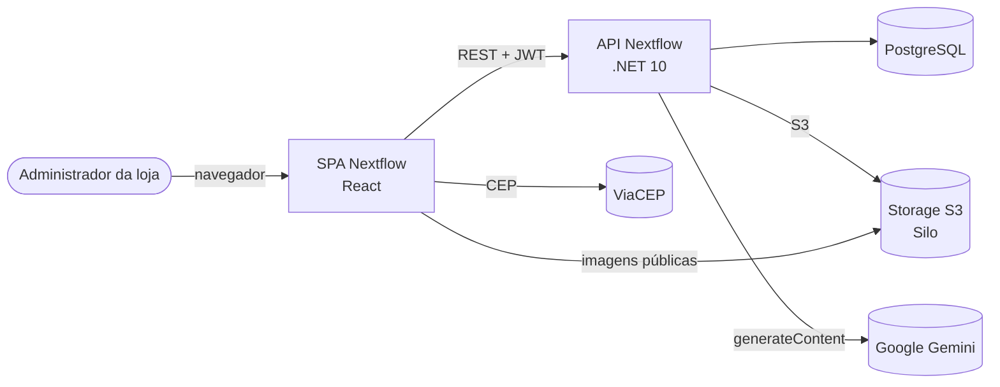
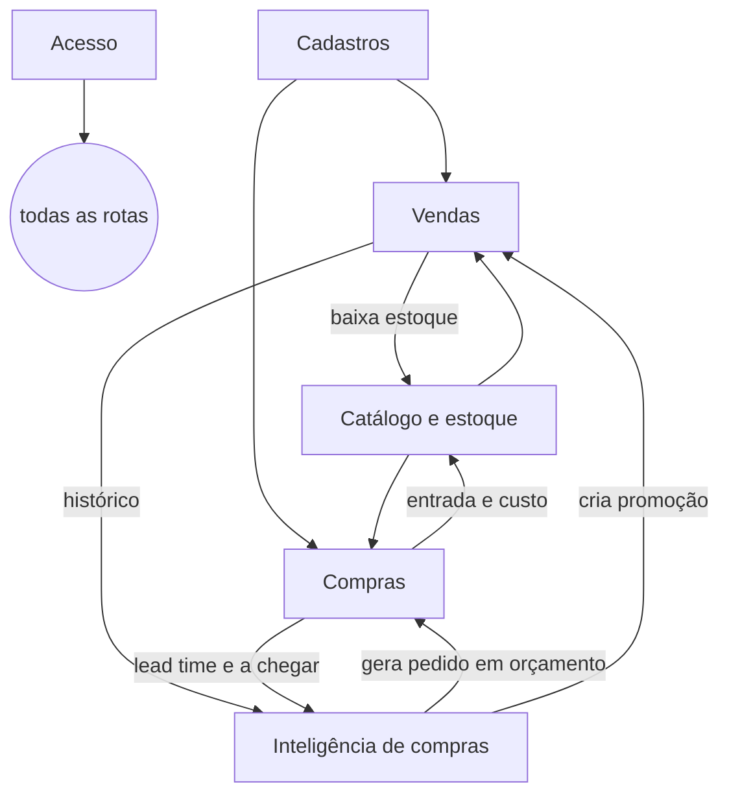

# Arquitetura — visão de alto nível (HLD)

> **Status:** rascunho / a validar · **Atualizado:** 2026-10-28
> **Origem:** `nextflow/docs/PROJECT.md`, `nextflow/docs/DOCKER.MD`, `nextflow-front/docs/PROJECT.md`, `AI_FORECAST_SPEC.md`
> (estado da branch `task-17`, não commitada em 28/10/2026). Detalhe de implementação fica nos docs dos repositórios.

## 1. Contexto

## 2. Containers e responsabilidades
| Peça | Tecnologia | Responsabilidade |
|--|--|--|
| SPA | React 19, TypeScript, Vite, Tailwind 4, shadcn/ui | Interface; nunca calcula preço nem regra de negócio |
| API | .NET 10, ASP.NET Core, EF Core | Regras de negócio, autenticação JWT, previsão |
| Banco | PostgreSQL | Dados transacionais e agregados da previsão; migrations aplicadas no startup |
| Storage | Silo (fork do MinIO), compatível com S3 | Imagens de produto (bucket público) e futuros anexos (privado) |
| IA | Google Gemini (atrás de `IAiClient`) | Prioriza e explica recomendações; opcional (sem chave = só cálculo) |
| ViaCEP | API pública | Preenchimento de endereço pelo CEP (front e API) |

## 3. Organização da API (Clean Architecture)
`Api → Application → Domain` e `Infrastructure → Domain`. Controllers finos; um use case por operação; Domain sem
dependências. Padrão de código do atrena-api (ADR 0010): `nextflow/docs/C_SHARP_ARCHITECTURE_RULES.md`.

## 4. Módulos
Proposta de módulos e o que cada um contém: `product-overview.md`, seção 5. Dependências principais:

## 5. Ambientes
| Ambiente | Onde | Como sobe | Observações |
|--|--|--|--|
| Desenvolvimento | máquina do dev | `docker compose -f compose.development.yaml up -d --build` (API e front) | portas só em `127.0.0.1`; seed demo ligado |
| Homologação (staging) | VM pessoal do Daniel | compose de staging atrás de um nginx de borda (`proxy-net`) | `nextflow.zanni.tech`, `nextflow-api.zanni.tech`, `nextflow-s3.zanni.tech` |
| Produção | não existe | — | a definir |

## 6. Atributos de qualidade (do TCC, a validar)
- RNF001 interface responsiva e acessível (WCAG) · RNF002 integridade do estoque e do histórico · RNF003 consultas < 2 s ·
  RNF004 senha com hash e JWT · RNF005 tudo em Docker · RNF006 Clean Architecture · RNF007 stack fixa (React/.NET/PostgreSQL).

## Perguntas em aberto
- Haverá produção de verdade (além da banca)? Onde?
- Multi-tenant (schema por empresa) muda esta visão; desenhar só depois do TCC (decisão 0003).
- Falta observabilidade (logs centralizados, métricas) e backup automatizado: é necessário para o TCC?
