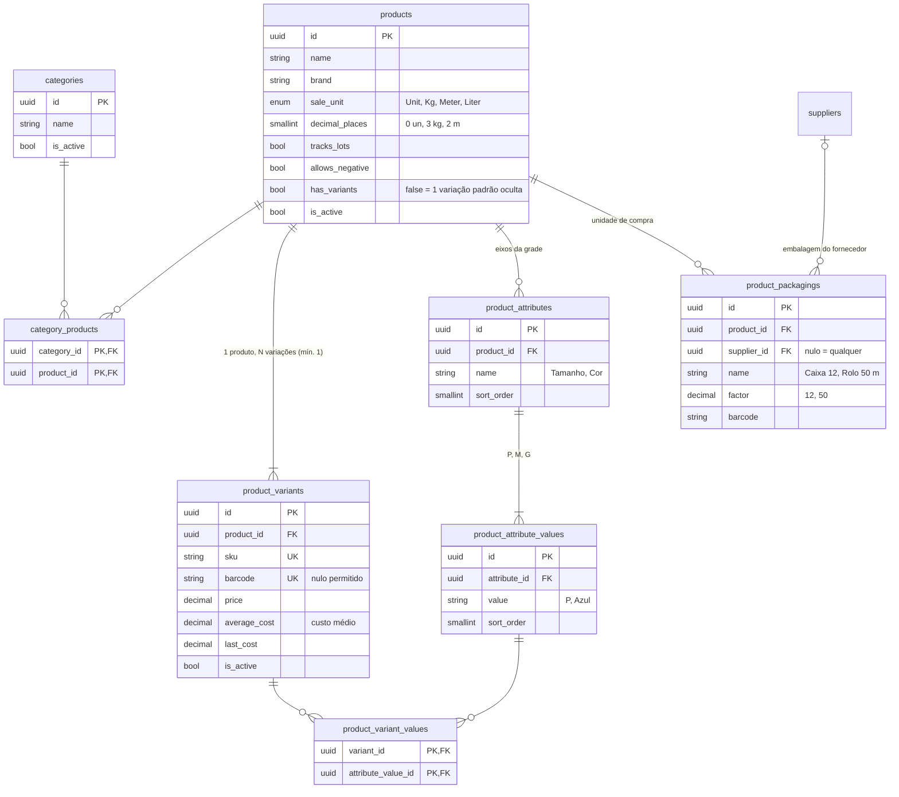
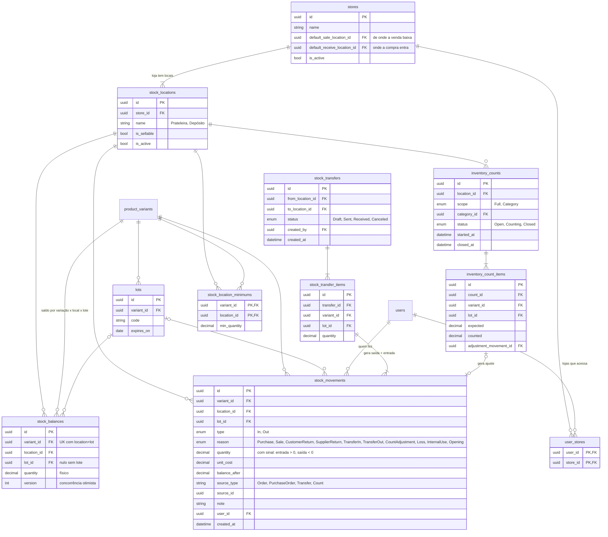
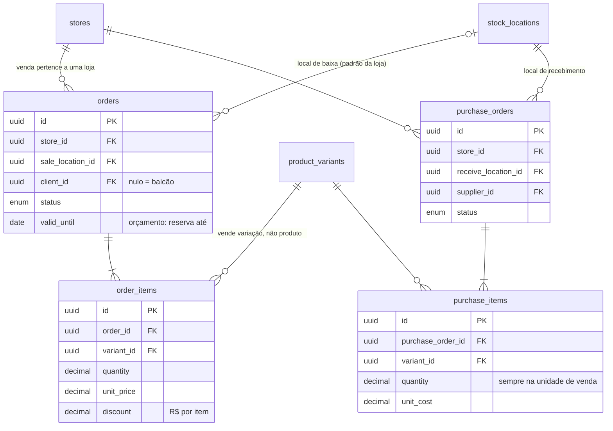

# DER — Catálogo e Estoque (proposta)

> **Status:** proposta de 28/10/2026, a validar com o Daniel · Base: rodada de estoque (itens 1 a 7) e lojas × locais
> Nomes de tabela e coluna seguem o padrão do código (inglês, snake_case plural).

## Fronteiras entre módulos (para não virar "ninho de rato")
| Módulo | Dono das tabelas | Quem pode ler | Quem pode escrever |
|--|--|--|--|
| Catálogo | `products`, `product_variants`, `product_attributes`, `product_attribute_values`, `product_variant_values`, `categories` | todos | só o Catálogo; `average_cost`/`last_cost` só pelo Estoque |
| Estoque | `stores`, `stock_locations`, `user_stores`, `lots`, `stock_balances`, `stock_location_minimums`, `stock_movements`, `stock_transfers*`, `inventory_counts*` | todos | **só o Estoque**, por um único serviço (`IStockLedger`) |
| Vendas / Compras | `orders*`, `purchase_*` | todos | o próprio módulo; mexem no estoque **chamando** o `IStockLedger`, nunca gravando saldo |

Regras de modelagem:
1. **Livro-razão:** `stock_movements` é a verdade e nunca é editado nem apagado (erro se corrige com movimento contrário).
   `stock_balances` é o saldo materializado, atualizado na mesma transação que grava o movimento, com `version` para concorrência.
2. **Tudo é variação:** produto sem grade tem uma variação padrão oculta. Venda, compra e estoque sempre apontam para `product_variants`.
3. **Reserva não é gravada:** disponível = `stock_balances.quantity` − itens de orçamentos válidos (`orders.valid_until`) da mesma loja.
4. **Quantidade em unidade de venda:** compra e venda sempre na unidade de venda (RN-CE30); sem conversão de embalagem.
5. **Custo médio por variação na empresa** (não por local); transferência não altera custo.
6. **Origem rastreável:** todo movimento tem `source_type` + `source_id` (pedido, compra, transferência, contagem) e `user_id`.

## 1 — Catálogo (SUBSTITUÍDA por `der-catalogo-v2-sazonalidade.md`; sem embalagem desde RN-CE30)

## 2 — Estoque, lojas e locais

## 3 — Pontos de contato com vendas e compras

