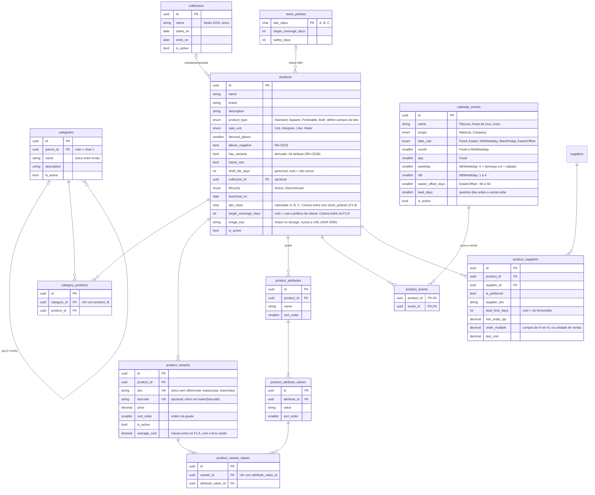
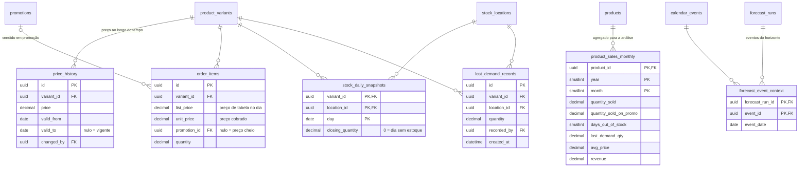

# DER — Catálogo v2 e dados para a sazonalidade (proposta)

> **Status:** proposta de 28/10/2026 a partir das respostas validadas RN-CE16 a RN-CE29 · substitui a parte 1 de `der-catalogo-estoque.md`

## Perfil de produto (`product_type`) — resposta ao item 5
O tipo define os padrões e os campos que a tela mostra, sem tabelas diferentes:
| Tipo | Liga por padrão | Campos que aparecem |
|--|--|--|
| Standard (papelaria, utilidades) | — | básico |
| Apparel (roupa, calçado) | `has_variants` | grade, coleção |
| Perishable (padaria, doces) | `tracks_lots`, `shelf_life_days` | lote, validade, unidade kg |
| Bulk (tecido, granel) | `sale_unit` = Meter/Kilogram | casas decimais, embalagem (rolo) |

## Como cada tabela alimenta a análise
- `product_sales_monthly` passa a ter, por mês: vendido, vendido em promoção, dias sem estoque, demanda perdida e preço médio.
  Assim o cálculo separa "vendeu porque era época" de "vendeu porque estava barato" e "não vendeu porque faltou".
- `stock_daily_snapshots`: saldo de fechamento por dia; 0 = dia sem estoque (job diário ou derivado das movimentações).
- `calendar_events` + `product_events`: datas do horizonte e quais produtos cada evento puxa (`lead_days` = antecedência).
- `lifecycle = Discontinued` nunca recebe "Comprar"; `shelf_life_days` limita a quantidade; `product_suppliers` traz prazo, mínimo e múltiplo.
- `abc_class` é recalculada a cada análise e escolhe a política (`stock_policies`) quando o produto não tem exceção.

## Catálogo v2

**Decisões da F1.3:** `sort_order` volta de `der-catalogo-estoque.md`, porque a ordem P, M, G é da grade e o rótulo depende dela; também nas variações. Tabelas de vínculo com `id` e índice único, como `user_stores`. `default_min_quantity` e as colunas acima marcadas ficam para a fatia que as usa. Cascata de `products` para atributos, valores, variações e vínculos existe para a sincronização do formulário (RN-CE51); `products` em si nunca é apagado.

## Dados para a sazonalidade

