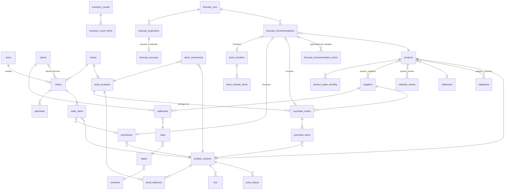
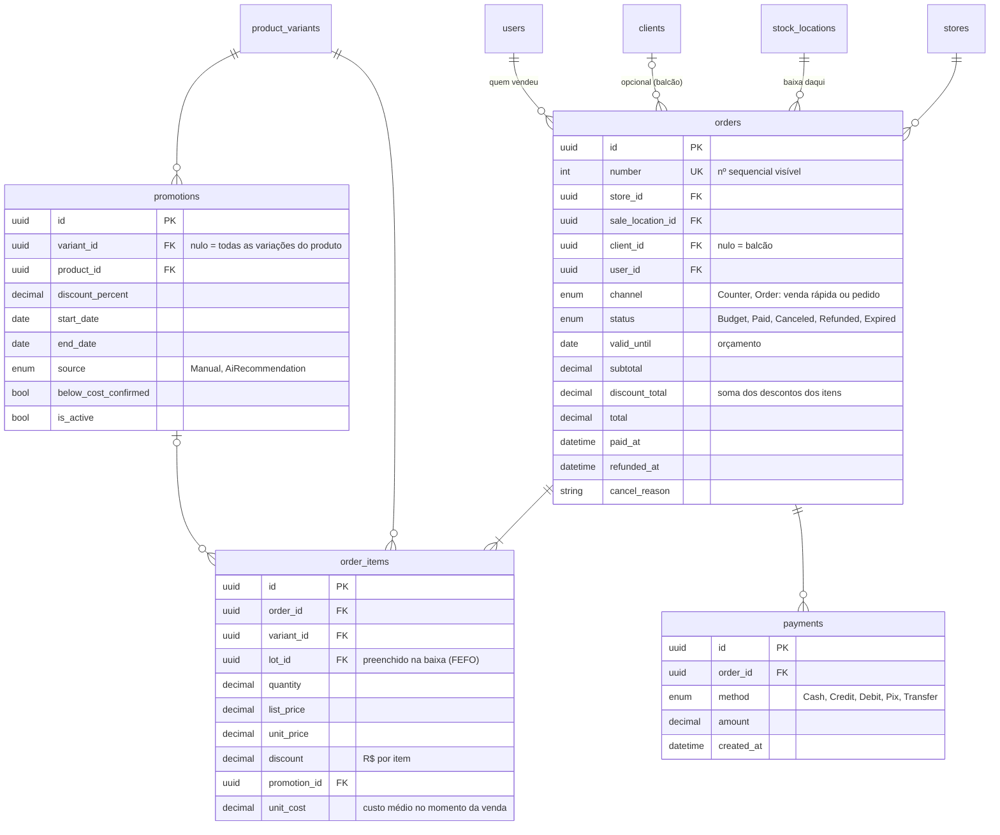
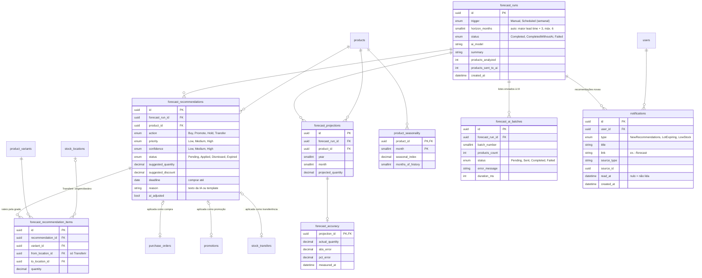
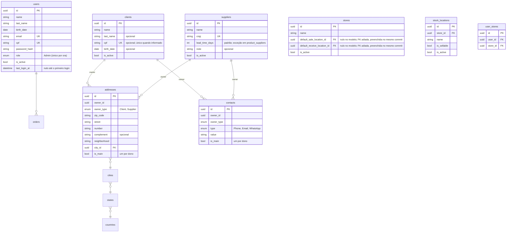

# DER consolidado do Nextflow (proposta)

> **Status:** proposta de 28/10/2026, consolidando as entrevistas de estoque, produto, vendas e compras · a validar
> Partes detalhadas: `der-catalogo-v2-sazonalidade.md` (catálogo + dados da sazonalidade), `der-catalogo-estoque.md`
> (parte 2: estoque, lojas e locais). Imagens: `der-0` a `der-7`.

## Mudanças em relação ao banco atual (branch `task-17`)
| Hoje | Proposta | Motivo |
|--|--|--|
| Item de pedido/compra aponta para `products` | aponta para `product_variants` | grade (RN-CE34) |
| `products.quantity` | `stock_balances` por variação × local × lote | depósitos e lotes (RN-CE09) |
| `stock_movements` com tipo simples | livro-razão com motivo, origem, custo e saldo após | rastreabilidade e sazonalidade (RN-CE14) |
| `CostPrice` = último custo | `average_cost` + `last_cost` na variação | custo médio (RN-CE31) |
| `orders` exige cliente | cliente opcional, `channel` Counter/Order | balcão (RN-VD15) |
| Status Budget/PendingPayment/PaymentConfirmed/Canceled/Refunded | Budget/Paid/Canceled/Refunded/Expired | dois estados de negócio (RN-VD16) |
| `sales` (1:1 com pedido) + `payments` | `payments` direto no pedido; `sales` removida | a venda é o pedido pago |
| Análise sob demanda, IA com até 40 produtos | job semanal + manual, IA em lotes sequenciais (`forecast_ai_batches`), `notifications` | RN-DF18, RN-DF20 |
| Recomendação Buy/Promote/Hold por produto | + Transfer, itens por variação e local, acerto medido | RN-DF16, rateio pela grade, `forecast_accuracy` |
| Categoria plana | `parent_id` (2 níveis) | RN-CE23 |

## Mapa geral

## Vendas

## Previsão

## Cadastros e acesso

