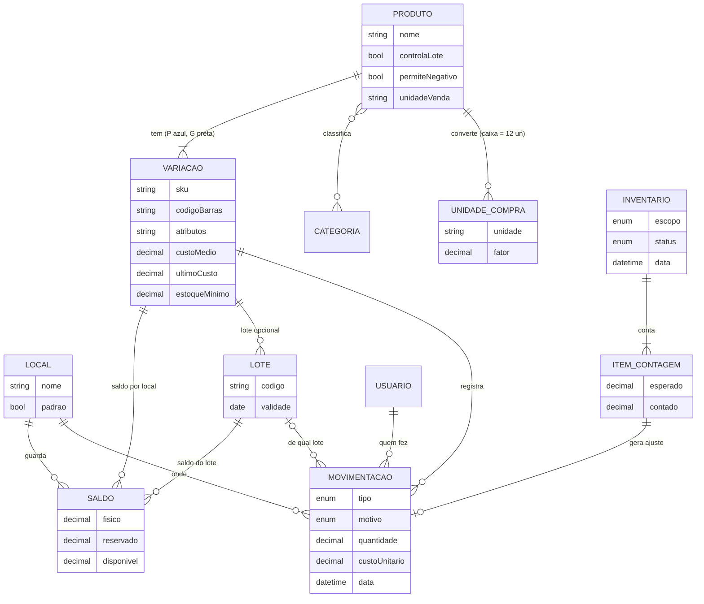

# Estoque — modelo proposto (ER)

> **Status:** proposta para a entrevista de 28/10/2026, a validar · Itens 1 a 7 da rodada de estoque

Tipos de movimentação: entrada por compra, saída por venda, devolução de cliente, devolução ao fornecedor,
transferência (sai de um local, entra no outro), ajuste de inventário e perda (motivo: quebra, vencimento, furto, uso interno).
`disponivel = fisico − reservado`; a reserva é calculada a partir dos orçamentos válidos.
