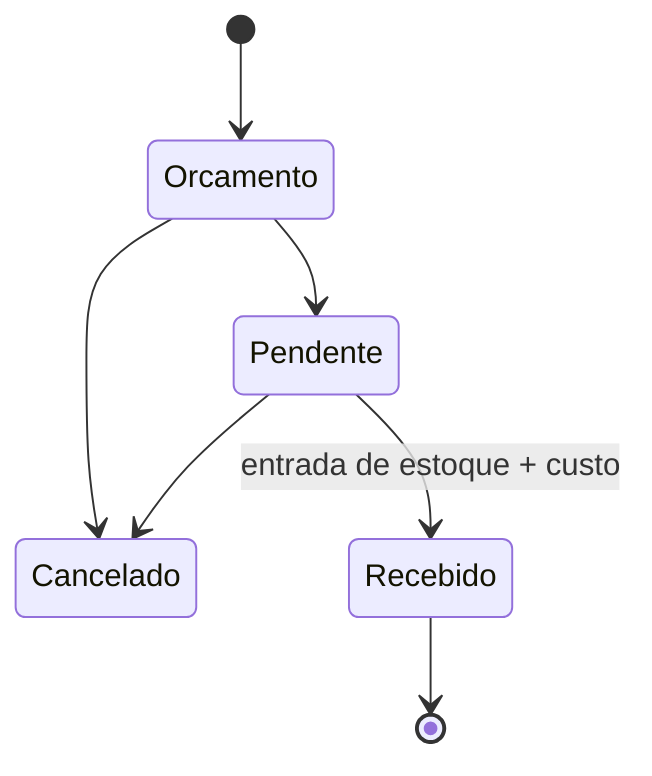

# Módulo Compras — visão

> **Status:** rascunho / a validar · **Atualizado:** 2026-10-28
> **Origem:** `nextflow/docs/PROJECT.md` (PurchaseOrdersController), `AI_FORECAST_SPEC.md`, decisão R5 do review

## O que faz hoje
Pedido de compra a um fornecedor, com itens e custo unitário. Status: Orçamento → Pendente → Recebido, ou Cancelado.
Ao receber: entrada de estoque por item, data de recebimento (`ReceivedAt`) e atualização do último custo do produto.
A previsão gera pedidos de compra em Orçamento, um por fornecedor.

## Perguntas em aberto
- Devolução ao fornecedor (o seed simula sobra de temporada) vira funcionalidade?
- Desconto e frete no pedido de compra (o diagrama de visão tem `Discount` no item)?
- Custo médio ponderado em vez de último custo?
