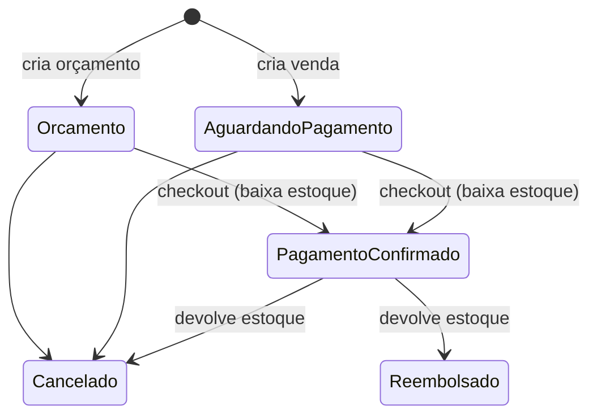

# Módulo Vendas — visão

> **Status:** rascunho / a validar · **Atualizado:** 2026-10-28
> **Origem:** `nextflow/docs/PROJECT.md`, `AI_FORECAST_SPEC.md` §4 e §7.2, `diagramas.md`, TCC (quadro 5), decisões R1, R3, R4 e R7 do review

## O que faz hoje
Pedido de venda nasce como **orçamento** ou **venda**, com itens a preço efetivo (com promoção vigente) e desconto por item.
O checkout registra um ou mais pagamentos (dinheiro, crédito, débito, transferência, Pix, boleto) e baixa o estoque.
Venda pode ser cancelada ou reembolsada, devolvendo o estoque. Promoções têm período e percentual e mudam o preço efetivo.

## Ciclo de vida do pedido (atual)

## Mudanças decididas, ainda não implementadas
- Desconto em R$ por item, total líquido (`decisions/0001`).
- Um único caminho de reembolso: Admin, até 7 dias (`decisions/0002`).
- Promoção abaixo do custo avisa e pede confirmação (`decisions/0003`).
- Orçamento com validade e reserva de estoque (`../catalog-inventory/decisions/0001`).

## Perguntas em aberto
- Diferença de negócio entre "cancelar" uma venda paga e "reembolsar": precisa existir as duas?
- Troca de produto (devolve um, leva outro) é um caso real do público-alvo?
- Venda sem cliente identificado (balcão)?
- Orçamento vencido: some, fica como "expirado" ou pode ser renovado?
